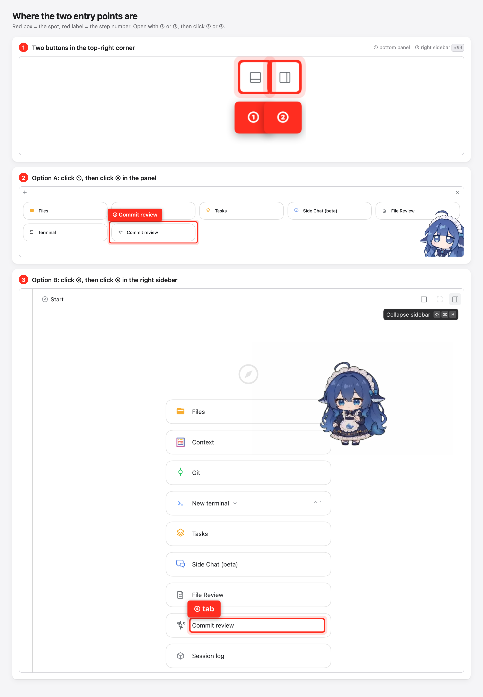
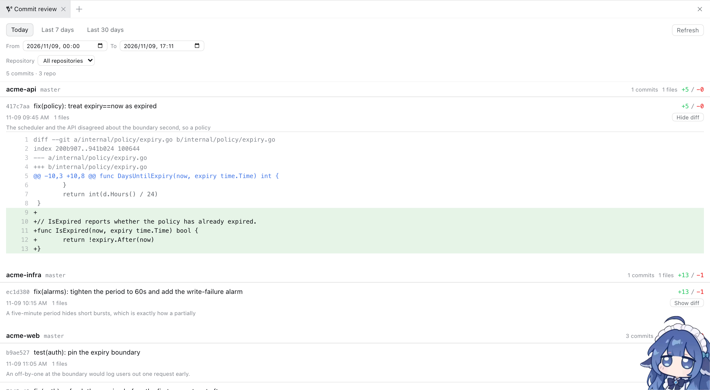

# Commit review — a DeepSeek Harness plugin

Turns "what did the agents actually change in this session?" into a permanent
sidebar tab, organised by **commit message**.

Read-only by design: the plugin only runs `git log` / `git show` /
`git rev-parse`. It never stages, commits, or writes anything.

> Chinese version: [README.zh-CN.md](README.zh-CN.md)

## Where the two entry points are



1. Click **① Expand bottom panel** (top-right) → a row of cards appears → click
   **③ `Commit review`**.
2. Or click **② Open right sidebar** (top-right, <kbd>⇧⌘B</kbd>) → click
   **④ `Commit review`** in the sidebar list.

Both buttons sit in the **top-right corner**, just left of `Split` /
`Fullscreen`. Same panel-shaped icon; one points down, one points right.

## What you get



Right sidebar → the **"Commit review"** tab:

- **Time range** presets at the top — **Today / Last 7 days / Last 30 days** — or
  pick `since` / `until` by hand.
- **Repository filter** for multi-repository workspaces (every git repository
  under the workspace is discovered; 55 in the author's workspace).
- One section per repository, commits newest first: short hash, timestamp,
  commit message, and `+N/−M`.
- **Show diff** on any commit → a unified diff with line-level red/green
  highlighting (`AbortController` cancellation; oversized diffs are truncated).
- Click **"N files"** → that commit's file list with per-file added/deleted
  counts.

## Install

```bash
# Use this directory's absolute path as the target
# (the example assumes you cloned to ~/dsh-plugins/commit-review)
dsh plugin --profile web add "$(pwd)"
```

Or have the agent call `plugin_manager`'s `install_bundle` with this
directory's absolute path as the target.

**You must restart `dsh web`** after installing so the host routes load, then
hard-refresh the browser (`Cmd+Shift+R`). `dsh plugin` installs the package into
the profile as a `link:`, so editing the source here and restarting is enough —
no reinstall needed.

> Writing to `~/.dsh` needs elevated permission; if `dsh plugin` fails with a
> permission error, retry with `danger-full-access`.

## Layout

| File | Purpose |
|---|---|
| `index.js` | Host half: registers the three read-only `GET /api/commit-review/{repos,summary,diff}` routes |
| `client.js` | Client half: registers the tab with `dsh-better-sidebar` and renders the commit list and diffs |
| `cordis.patch.yml` | Bundle patch that inserts this package into the host composition |
| `locale/{en,zh}.json` | Plugin metadata (tab title and description) |

Host and Client share one literal prefix, `api/commit-review`. The Client uses a
same-origin relative path with no leading slash.

## Two pitfalls already hit (don't reintroduce them)

1. **The `git log` record separator must OPEN the format, not close it.**
   `--numstat` appends its file rows **after** the format output, so a trailing
   `\u001e` pushes every commit's file rows into the next record — and every
   commit ends up showing `files=0 +0/−0`. Correct form:
   `\x1e%H\x1f%aI\x1f%s\x1f%b`.

2. **Read `ctx.sessions` from the context inside the inject callback.**
   A cordis service is only readable from the fiber that declared it; reading it
   from the outer `apply(ctx)` context throws
   `cannot get property "sessions" without inject`, which surfaces as an HTTP 400
   on the routes. All three handlers therefore take `scoped` from
   `ctx.inject(['webServer','sessions'], (scoped) => …)` and pass `scoped` into
   `sessionCwd()`.

## One design trade-off

`SessionStore.get(id)` only returns sessions **live in process memory**. After a
server restart an older session is no longer in memory, so resolving the
workspace from `sessionId` alone fails. The Client therefore also sends the
sidebar scope's `cwd`, and the Host falls back to it when the session is not in
memory (`sessionCwd(scoped, sessionId, explicit)`).
