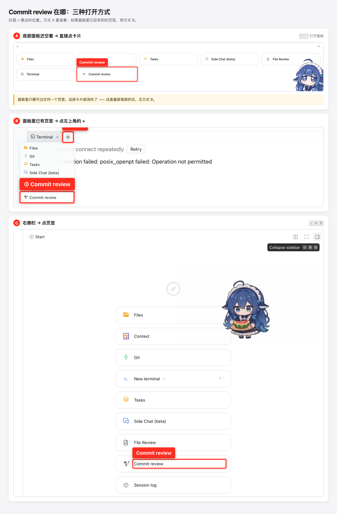
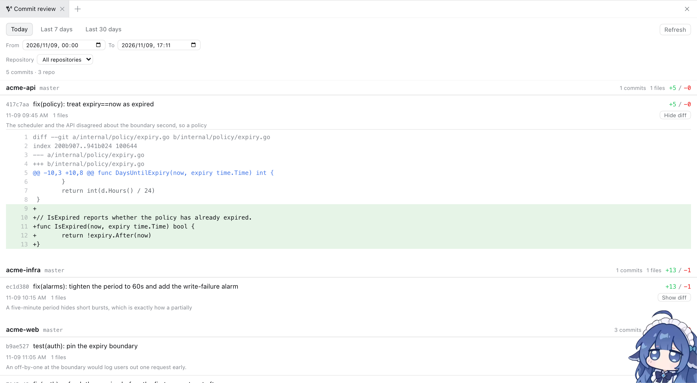

# Commit review — DSH 插件

> English version: [README.md](README.md)

把「这次会话里 AI agent 到底改了什么」按 **commit message** 组织成一个常驻侧栏页签。

数据只读：插件只跑 `git log` / `git show` / `git rev-parse`，不 stage、不 commit、不写盘。

## 入口在哪（找不到页签时先看这张图）



**方式 A —— 底部面板还空着时**：点右上角的 `Expand bottom panel`（<kbd>⌃</kbd><kbd>\`</kbd>），面板里会出现一排卡片，点 `Commit review`。

**方式 B —— 底部面板里已经有页签时**：那排卡片会消失，只剩页签栏。点**底部面板自己的页签栏最左端**那个小 **`+`**，菜单里就有 `Commit review`。

> 注意窗口里有**两个长得一样的 `+`**：右上角那个是「新建会话页签」，点它只会开一个新会话；要的是**底部面板内部**、紧贴面板左边缘的那个 `+`。

**方式 C —— 右侧栏**：点右上角的 `Open right sidebar`（<kbd>⇧</kbd><kbd>⌘</kbd><kbd>B</kbd>），在列表里点 `Commit review`。

> **最容易踩的坑**：方式 A 的卡片只在面板**完全空着**时出现。只要你在这个面板里开过 `Terminal`、`Git` 之类任何一个页签，卡片就永久消失了（DSH 会记住布局）—— 这时候不是插件没装上，而是要用方式 B 的 `+`。

## 它长什么样



右侧栏 → **「提交审查 / Commit review」** 页签：

- 顶部时间范围：**今天 / 近 7 天 / 近 30 天**，或手动选 `since` / `until`；
- 多仓工作区可以按 **仓库** 过滤（本工作区下 55 个 git 仓都会被扫到）；
- 每个仓库一段，按时间倒序列出提交：短 hash、时间、commit message、`+N/−M`；
- 点某个提交的 **展开 diff** → 行级红绿高亮的 unified diff（`AbortController` 取消、超大 diff 截断）；
- 点「N 个文件」→ 该提交的文件清单与每个文件的增删行数。

## 安装

```bash
# 用本目录的绝对路径作为 target（示例假设你 clone 到了 ~/dsh-plugins/commit-review）
dsh plugin --profile web add "$(pwd)"
```

或者让 agent 调 `plugin_manager` 的 `install_bundle`（target 传本目录的绝对路径）。

安装后 **必须重启 `dsh web`** 才会加载 host 侧路由，然后浏览器 `Cmd+Shift+R` 硬刷新。
`dsh plugin` 把包以 `link:` 形式装进 profile，改这里的源码后重启即生效，无需重新安装。

> 写 `~/.dsh` 需要较高权限；如果 `dsh plugin` 报权限错误，用 `danger-full-access` 重试。

## 结构

| 文件 | 作用 |
|---|---|
| `index.js` | Host 半：注册 `GET /api/commit-review/{repos,summary,diff}` 三条只读路由 |
| `client.js` | Client 半：向 `dsh-better-sidebar` 注册页签，渲染提交列表与 diff |
| `cordis.patch.yml` | bundle 补丁，把本包作为插件插入宿主组合 |
| `locale/{en,zh}.json` | 插件元数据（页签标题/描述） |

Host 与 Client 用同一份字面量前缀 `api/commit-review`（Client 用同源相对路径，无前导斜杠）。

## 两个已经踩过的坑（改代码时别踩回去）

1. **`git log` 的记录分隔符必须放在 format 开头。**
   `--numstat` 的文件行是追加在 format 输出**之后**的，`\u001e` 放末尾会把每个提交的文件行推到下一条记录，
   结果是所有提交都显示 `files=0 +0/−0`。正确写法：`\x1e%H\x1f%aI\x1f%s\x1f%b`。

2. **读 `ctx.sessions` 必须用 inject 回调里的那个 context。**
   cordis 的服务只能在声明它的 fiber 上读；在 `apply(ctx)` 的外层 ctx 上读会抛
   `cannot get property "sessions" without inject`，表现为路由 400。所以三条 handler 都通过
   `ctx.inject(['webServer','sessions'], (scoped) => …)` 拿 `scoped`，再把 `scoped` 传进 `sessionCwd()`。

## 一个设计上的取舍

`SessionStore.get(id)` 只返回**进程内存里的活跃会话**。服务重启后老会话不在内存里，
这时如果只靠 `sessionId` 解析工作区就会失败。所以 Client 会把侧栏 scope 里的 `cwd` 一起传上来，
Host 在「会话不在内存」时退回用它解析（`sessionCwd(scoped, sessionId, explicit)`）。
